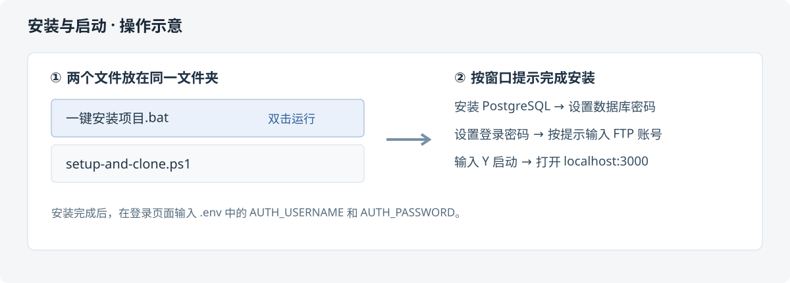
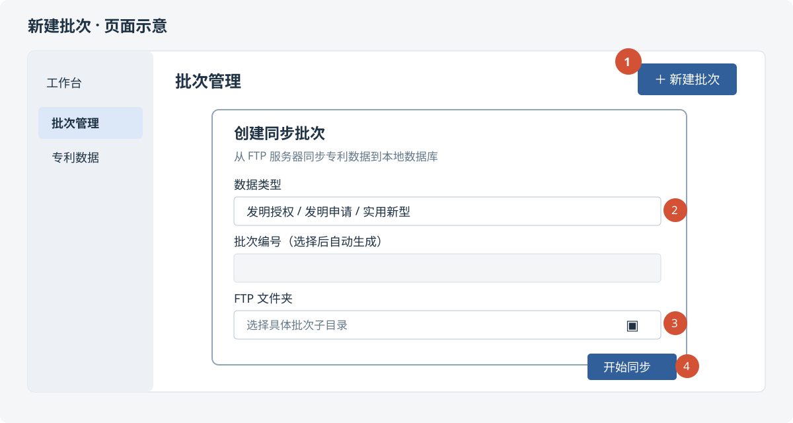

# 项目下载与数据导入说明报告

本报告适用于在新电脑上部署专利 ETL 工作台，并通过 FTP 下载和导入专利批次。以下命令以 Windows PowerShell 为例。项目负责数据同步和检索；FTP、数据库及对象存储需要事先具备可用的访问权限。

文中配图根据当前页面和安装流程绘制，均为**操作示意图**，不是实际运行截图；路径、状态和数量以实际页面为准。

## 一、准备工作

1. 安装 Git、Node.js 22 和 pnpm 10.32.1。项目 Dockerfile 使用 Node.js 22，包管理器版本记录在 `package.json`。可执行 `node -v`、`git --version`、`pnpm -v` 检查；如尚未安装 pnpm，可执行 `corepack enable` 和 `corepack prepare pnpm@10.32.1 --activate`。
2. 使用一键安装时，准备 64 位 Windows 电脑、可用的 winget 和软件安装权限，并确认可以联网下载软件。手动安装时需自行准备 PostgreSQL 和 MinIO 或其他受支持的对象存储。
3. 准备 FTP 访问账号与数据目录；FTP 数据源由数据提供方提供，安装脚本不会创建 FTP 账号或下载专利数据。
4. 预留充足磁盘空间、网络带宽和运行时间。一个原始批次可能约 5 GB，处理时还会产生合并文件、解压文件及解析结果，实际空间需求高于下载体积。先选定一个批次验证，不要一次启动大量批次。
5. 向项目负责人安全获取仓库访问权限和实际服务配置。不要通过公开渠道发送 `.env`、密码或密钥，也不要将其提交到 Git。

### 获取 FTP 账号和地址

1. 访问国家知识产权局[知识产权数据资源公共服务系统](https://ipdps.cnipa.gov.cn/#/Login)，按页面要求注册并登录。
2. 在系统“数据资源目录”中查看需要的数据，在“下载中心”查看 FTP 地址和下载说明。下载账号、密码及数据权限以系统实际提供的信息为准；如有疑问，可查看该系统的帮助信息或联系其技术支持。
3. 安装项目时，按提示输入 FTP 用户名和密码；地址与数据目录按下载中心实际信息核对。如果使用单位提供的 FTP 数据源，请向单位管理员获取对应账号和地址。

上述途径依据国家知识产权局的[专利基础数据开放办事指南](https://ggfw.cnipa.gov.cn/portal/helper/zhinan.pdf)及[咨询答复](https://www.cnipa.gov.cn/jact/front/mailpubdetail.do?sysid=12&transactId=485657)整理，具体注册和下载步骤以系统最新页面为准。

## 二、下载项目与安装依赖

### 方式一：双击安装



将 `scripts/一键安装项目.bat` 和 `scripts/setup-and-clone.ps1` 一起交给使用者，放在同一文件夹。双击 `一键安装项目.bat`，按窗口提示操作。程序自动检查并按需安装 Node.js、Git、Corepack、PostgreSQL 和项目依赖，直接下载运行 Windows 版 MinIO，创建数据库及图片存储桶。PostgreSQL 安装向导中使用端口 5432，设置并记住数据库密码。随后在安装窗口设置并确认工作台登录密码，默认登录账号为 `admin`。为兼容配置文件，数据库密码和登录密码仅使用英文字母、数字、下划线、点或连字符，登录密码至少 8 位。安装窗口还可输入 FTP、过滤白名单和可选 AI 服务配置。项目默认安装在两个文件所在文件夹的 `patent-etl-nodejs` 子目录；已有该项目时可按提示继续安装，程序不会自动更新代码或覆盖已有登录密码。

具体操作：

1. 将上述两个文件放进同一个文件夹，双击 `一键安装项目.bat`。如 Windows 请求安装权限，按提示授权。
2. PostgreSQL 安装向导出现时，保留端口 `5432`，设置数据库用户 `postgres` 的密码并记住。之后在脚本弹出的凭据窗口输入该账号及密码。
3. 按安装窗口提示输入两次工作台登录密码，输入时密码不会显示；默认登录账号是 `admin`。如果项目已有 `.env`，安装程序会保留其中的登录配置。
4. 依次填写负责人提供的 FTP 账号和密码；FTP 地址、端口和数据根目录可按提示沿用模板。首次安装必须输入账号和密码，密码输入时不会显示；已有 `.env` 时可选择保留现有配置。
5. 按提示决定是否修改专利过滤白名单，是否配置 AI 检索式服务。跳过时沿用模板白名单；AI 可跳过，下载和导入不依赖它。配置 FTP 和 AI 密钥时，脚本支持 `$` 和 `#`，不支持在提示中输入换行、双引号和反斜杠；如凭据含这些字符，请稍后通过 `.env` 正确填写。
6. 可按提示打开 `.env` 检查配置。随后输入 `Y` 并按回车启动。保持窗口打开，在浏览器访问 `http://localhost:3000`，使用已设置的账号密码登录。

下载和安装需要网络；Windows 安装器可能要求授权。安装使用本机端口 5432、9000 和 9001。MinIO 数据保存在项目 `data/local-services/minio-data` 目录，需妥善备份；安装程序重新运行时会重新启动 MinIO。`.env` 包含凭据，应妥善保管。分类字典查询使用 PostgreSQL，字典数据需单独导入，详见 `docs/ipc-cpc-data-sources.md`。安装程序不导入专利批次数据，启动后请按第五节操作。

### 方式二：手动安装

在希望存放项目的目录打开 PowerShell：

```powershell
git clone https://github.com/guowei1123/patent-etl-nodejs.git
cd patent-etl-nodejs
corepack enable
corepack prepare pnpm@10.32.1 --activate
pnpm install --frozen-lockfile
```

如仓库为私有仓库，请先取得授权并按 Git 提示完成身份验证。若已经收到完整项目文件夹，可直接进入该文件夹，从安装依赖开始。

## 三、配置运行环境

**双击安装的用户：**安装程序会创建 `.env` 并引导输入配置；不要再次执行下面的复制命令，以免覆盖已有配置。本节命令主要用于手动安装。

在项目根目录复制模板并编辑：

```powershell
Copy-Item .env.example .env
notepad .env
```

按照负责人提供的实际环境修改以下配置，保留模板中其他需要的设置：

| 配置项 | 用途 |
| --- | --- |
| `CNIPA_PG_HOST`、`CNIPA_PG_PORT`、`CNIPA_PG_DB`、`CNIPA_PG_USER`、`CNIPA_PG_PASSWORD` | PostgreSQL 连接信息 |
| `CNIPA_FTP_HOST`、`CNIPA_FTP_PORT`、`CNIPA_FTP_USER`、`CNIPA_FTP_PASSWORD`、`CNIPA_FTP_DATA_PATHS` | FTP 连接信息及数据目录 |
| `OBJECT_STORAGE_TYPE`、`MINIO_ENDPOINT`、`MINIO_ACCESS_KEY`、`MINIO_SECRET_KEY`、`MINIO_BUCKET_NAME`、`MINIO_REGION` | 使用 MinIO 时的附图存储配置 |
| `CLASSIFICATION_STORE` | 一键安装设置为 `postgres`，分类字典使用 PostgreSQL |
| `AUTH_USERNAME`、`AUTH_PASSWORD`、`SESSION_SECRET_KEY` | 本地登录账号、密码和会话密钥；设置独立强密码及随机密钥 |
| `PATENT_FILTER_IPC_WHITELIST`、`PATENT_FILTER_ENTITY_WHITELIST` | 导入过滤范围；应与负责人确认，避免误以为所有原始专利都会入库 |
| `OPENAI_BASE_URL`、`OPENAI_CHAT_MODEL`、`OPENAI_API_KEY` | 可选；使用 AI 检索式生成功能时填写，普通数据同步不需要 |

模板中的值不一定适用于实际环境，FTP 等账号信息应以负责人提供的有效配置为准。FTP 根目录依次对应发明授权、实用新型、发明申请，使用英文逗号分隔；模板未必包含三类目录，应向数据提供方确认。导入按 IPC 或实体白名单过滤，两项都为空时不会匹配到专利。默认处理会上传附图；如明确只需要文本，可设置 `PROCESS_UPLOAD_IMAGES=0`，此时不会上传附图或生成图片元数据。语义检索还需额外配置 embedding 模型，参见 `.env.example`。更改 `.env` 后重启服务。

## 四、启动与登录

### 一键启动


安装完成后，将 `scripts/一键启动项目.bat` 和 `scripts/start-project.ps1` 放在**同一个文件夹**。若使用前面的双击安装方式，请把两个启动文件放在安装文件所在的文件夹；也可直接使用项目 `scripts` 文件夹中的两个文件。

双击 `一键启动项目.bat`，脚本会检查配置、数据库和对象存储，必要时尝试启动本机 PostgreSQL 和 MinIO。工作台就绪后会自动打开浏览器；如果没有自动打开，请访问 `http://localhost:3000`。使用 `.env` 中的 `AUTH_USERNAME` / `AUTH_PASSWORD` 登录。

使用期间保持启动窗口打开；关闭窗口后，后台监控程序会停止本项目配置对应的本地 PostgreSQL 服务和 MinIO 进程，包括启动前已在运行的对应服务。其他程序若正在使用该数据库，也会受到影响。启动脚本会请求管理员权限，以便管理 Windows 服务；远程服务不会由脚本停止。启动窗口提示端口占用或服务连接失败时，请按提示检查后重试。启动脚本适用于前述本地安装方式，不会重新安装软件或下载专利批次。

### 手动启动

```powershell
pnpm dev
```

保持该终端运行，在浏览器访问 `http://localhost:3000`，使用 `.env` 中的 `AUTH_USERNAME` 和 `AUTH_PASSWORD` 登录。首次启动时应用会在后台尝试初始化数据库和同步调度器；若初始化失败，检查终端日志、数据库连接及权限，并在修复后重启服务。打开“专利数据”页面也可触发数据库初始化。

## 五、下载并导入数据

### 第一步：创建批次并选择数据



图中数字对应以下操作：

1. 登录后在左侧选择“批次管理”，点击右上角 **“新建批次”**。
2. 在弹出的“创建同步批次”窗口中，选择 **数据类型**：发明授权、发明申请或实用新型。类型要与 FTP 数据目录一致。
3. 点击 **“FTP 文件夹”**输入框右侧的文件夹图标。在目录窗口中，**双击进入文件夹、单击选中目录**，选中具体批次子目录后点击“确定选择”。不要选数据根目录；也可直接输入正确的批次路径。选好后，批次编号自动生成。
4. 检查数据类型和文件夹，点击 **“开始同步”**。此操作会将批次加入自动队列并启动下载；开始前确认已获得数据下载授权，且磁盘空间和网络足够。

如果目录打不开，请先检查 `.env` 中的 FTP 地址、账号密码及网络，再重试。

### 第二步：查看下载和导入进度


创建成功后进入批次详情页，系统会自动排队执行 **下载 → 处理 → 导入**，不需要依次手动点击三个步骤。下载支持断点续传；处理阶段校验文件、解析 XML 并按配置上传附图；导入阶段写入 PostgreSQL。

在详情页查看当前状态、已导入数量和“同步日志”。等待期间保持应用及相关服务可用；进程重启后，租约过期的任务会重新排队。若状态为“失败”，查看日志并先修复相应的网络、数据库、磁盘或对象存储问题，再按页面提示操作。

### 第三步：检查导入结果

1. 等待批次状态显示 **“已完成”**，检查详情页的导入数量和同步日志。
2. 在左侧打开 **“专利数据”**，输入已知的专利信息进行搜索，打开记录抽查标题、申请人、正文和应有的附图。
3. 如数量少于原始数据，先核对过滤白名单和日志。去重更新及过滤条件可能使实际入库数量与原始记录数不同。

详情页保留下载、处理、导入等手动操作，点击会将对应阶段加入或提升队列优先级，并不会绕过并发限制。自动队列在导入校验成功后会清理该批次本地临时文件；如需保留原始文件，请在运行前另行规划备份。

## 六、常见问题

| 现象 | 排查与处理 |
| --- | --- |
| 无法安装依赖 | 检查 Node.js、pnpm 版本和网络；在项目根目录重新执行安装命令。 |
| 页面无法访问或登录失败 | 确认 `pnpm dev` 正在运行、3000 端口可用；核对本机 `.env` 登录配置，修改后重启。 |
| 数据库初始化或导入失败 | 检查 PostgreSQL 服务、连接信息、网络及建表权限；查看终端和批次日志。 |
| FTP 目录无法浏览或下载失败 | 检查账号权限、目录、网络和 FTP 连接数限制；下载中断后可重试，已有部分文件支持续传。 |
| 处理失败或附图无法显示 | 查看批次日志，检查磁盘空间、压缩包校验结果、对象存储地址、存储桶及读写权限。 |
| 批次失败或状态异常 | 先查看详情日志并修复原因，再使用详情页的“修复状态”及相应阶段操作重试；不要随意删除批次文件。 |
| 已完成但查询数量少于预期 | 核对过滤白名单、批次日志和实际数据范围；导入使用去重更新，不能直接以文件数推断新增记录数。 |

更多技术细节见 `docs/data-pipeline.md`；项目附带的历史数据、PDF 和分类字典导入属于其他流程，分别参阅 `features/historical-import/README.md`、`features/historical-import/pdf/README.md` 和 `docs/ipc-cpc-data-sources.md`。
